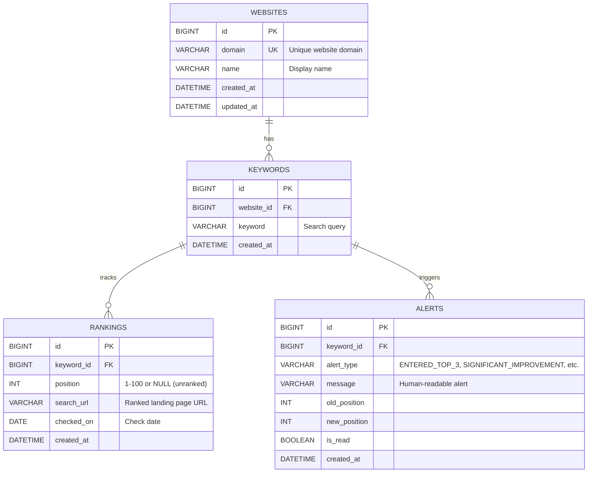

# RankPulse – SEO Rank Tracking & Analytics Platform

[](https://openjdk.org/)
[](https://spring.io/projects/spring-boot)
[](https://www.mysql.com/)
[](https://react.dev/)
[](https://vitejs.dev/)

A production-grade, full-stack SEO Rank Tracking and SERP Analytics SaaS platform built with **Java 21**, **Spring Boot 3.4**, **Spring Data JPA**, **MySQL / H2**, and **React 19**.

RankPulse automates the tracking of Google keyword ranking positions across the top 100 organic search results via SearchAPI.io, monitors historical SERP movements over time, triggers real-time alerts for significant rank changes, and provides interactive analytics with customized charts and performance breakdowns.

---

## 📑 Table of Contents

- [Features](#-features)
- [Application Screenshots](#-application-screenshots)
- [Technology Stack](#-technology-stack)
- [System Architecture](#-system-architecture)
- [Database Design & Schema](#-database-design--schema)
- [REST API Overview](#-rest-api-overview)
- [Installation & Setup](#-installation--setup)
  - [Prerequisites](#prerequisites)
  - [Environment Variables](#environment-variables)
  - [MySQL Configuration](#mysql-configuration)
  - [Backend Startup](#backend-startup)
  - [Frontend Startup](#frontend-startup)
- [SearchAPI.io Integration](#-searchapiio-integration)
- [Future Enhancements](#-future-enhancements)
- [License](#-license)

---

## 🚀 Features

### 1. Multi-Website Domain Management
- Add, update, view, and delete tracked websites/domains.
- Independent multi-domain isolation: track company domains alongside competitor properties.
- URL and domain normalization: strips protocols (`http://`, `https://`), `www.`, and trailing paths.

### 2. Keyword Management & SERP Tracking
- Add search queries per website with real-time validation and duplicate prevention (`uk_website_keyword`).
- Instant on-demand SERP check on keyword addition.
- Manual one-click rank checking per keyword or across all website keywords.
- Paginated keyword list with real-time position badges, 30-day position movement, best achieved rank, and ranked landing page URLs.

### 3. Automated Daily Scheduling
- Spring `@Scheduled` cron job executes automatic daily ranking checks across all tracked keywords.
- Fault-tolerant background processing: individual keyword check failures do not stop the batch process.
- Duplicate check suppression: avoids redundant API credit usage by checking if today's ranking has already been fetched (`existsByKeywordIdAndCheckedOn`), while allowing forced manual refreshes.

### 4. Interactive Analytics & Data Visualizations
- **Summary KPI Cards**: Total Keywords, Average SERP Position, Top 10 Visibility, Improved Keywords, and Declined Keywords.
- **Ranking Trend Chart**: Interactive line chart showing daily average ranking trends with an inverted Y-axis (position #1 at the top).
- **Ranking Distribution Chart**: Bar visualization categorizing keywords across standard SEO tiers (Top 3, Top 10, Top 20, Top 50, Top 100, 100+).
- **Granular Ranking History**: Modal and dedicated history views showing historical ranking logs for each keyword over customizable date ranges.

### 5. Automated Ranking Alerts
- Automatically triggers notifications when significant SERP events occur:
  - **Entered Top 3**: High-priority commercial ranking achievement.
  - **Entered Top 10**: First-page Google SERP entrance.
  - **Significant Improvement**: Ranking improved by 5 or more positions.
  - **Significant Decline**: Ranking dropped by 5 or more positions.
  - **Dropped from Top 100**: Keyword fell out of Google's top 100 results.
- Unread badge counter in top navigation and mark-as-read / mark-all-read controls.

---

## 📸 Application Screenshots


---

## 🛠️ Technology Stack

### Backend
- **Language**: Java 21 LTS
- **Framework**: Spring Boot 3.4.3
- **Web Layer**: Spring MVC / RESTful APIs
- **Persistence**: Spring Data JPA, Hibernate 6.6
- **Database**: MySQL 8.x 
- **HTTP Client**: Spring `RestClient` (SearchAPI.io Google Rank Tracking Engine)
- **Scheduling**: Spring Task Scheduling (`@EnableScheduling`, cron-based)
- **Build Tool**: Apache Maven 3.9+
- **Testing**: JUnit 5

### Frontend
- **Framework**: React 19
- **Build & Dev Tool**: Vite 8.3
- **Language**: Modern JavaScript (ES2024), HTML5, CSS3
- **Routing**: React Router v7
- **Charts & Visualizations**: Recharts 3.x
- **HTTP Client**: Axios with centralized error interceptors
- **Icons**: Custom SVG vector icon system (zero external emoji icons)

---

## 🏛️ System Architecture

The backend implements a clean **Layered Architecture** adhering to separation of concerns:

```
com.demo.ranktracker
├── client            # External HTTP integration (SearchAPI.io Google Rank Tracking engine)
├── config            # Security/CORS configuration, scheduling, and database seeding
├── controller        # REST Controllers (Website, Keyword, Ranking, Analytics, Alert)
├── dto               # Immutable Java records for requests, responses, and DTO projections
├── entity            # JPA Entities (Website, Keyword, Ranking, Alert)
├── exception         # Global Exception Handler (@RestControllerAdvice) and custom exceptions
├── repository        # Spring Data JPA Repositories with custom JPQL queries
└── service           # Transactional business logic, domain matching, and alert detection
```

### Architectural Highlights
- **DTO Projections & Information Hiding**: Database entities never leak to the REST API layer. Immutable Java records enforce strict API contracts.
- **Resilient Domain Matching**: The rank-checking engine normalizes URLs, compares clean hostnames, and matches across root domains, subdomains (e.g. `docs.spring.io` matching `spring.io`), and URI paths.
- **Global Error Handling**: Centralized `@RestControllerAdvice` translates domain exceptions (`ResourceNotFoundException`, `DuplicateResourceException`, `RankCheckException`) into structured JSON `ApiErrorResponse` payloads with RFC 7807 compliance.
- **Credit Conservation**: Prevents redundant third-party API spend by verifying daily existence before querying SearchAPI.io.

---

## 🗄️ Database Design & Schema

The relational database schema is normalized with foreign key constraints, composite unique indexes, and cascade-delete rules:



### Schema Constraints
- `uk_website_keyword`: `UNIQUE (website_id, keyword)` prevents duplicate keywords for the same domain.
- `uk_keyword_date`: `UNIQUE (keyword_id, checked_on)` prevents duplicate daily ranking entries.
- `idx_ranking_keyword` & `idx_ranking_date`: B-Tree indexes for fast range queries and chart timeline rendering.
- `position`: `INT NULL` (values 1–100 represent organic SERP positions; `NULL` explicitly represents unranked / 100+).

---

## 📡 REST API Overview

| Endpoint | Method | Description |
|---|---|---|
| `/api/websites` | `GET` | List all tracked websites with keyword counts |
| `/api/websites` | `POST` | Register a new website domain |
| `/api/websites/{id}` | `GET` / `PUT` / `DELETE` | Retrieve, update, or delete a website |
| `/api/websites/{id}/keywords` | `GET` | Paginated keywords for a website (supports `?search=&page=&size=`) |
| `/api/websites/{id}/keywords` | `POST` | Add keyword and trigger immediate initial rank check |
| `/api/keywords/{id}` | `DELETE` | Delete keyword and its historical ranking records |
| `/api/rankings/check/{keywordId}` | `POST` | Trigger on-demand rank check for a single keyword |
| `/api/rankings/check/website/{websiteId}` | `POST` | Trigger rank check for all keywords of a website |
| `/api/keywords/{keywordId}/rankings` | `GET` | Retrieve keyword ranking history with best rank (`?startDate=&endDate=`) |
| `/api/analytics/dashboard/{websiteId}` | `GET` | Summary statistics (Total, Average, Top 10, Top 100, Movements) |
| `/api/analytics/performance/{websiteId}` | `GET` | Performance table data with current/previous positions and change |
| `/api/analytics/trends/{websiteId}` | `GET` | Daily trend lines for charts |
| `/api/analytics/distribution/{websiteId}` | `GET` | Tier distribution breakdown (Top 3, 10, 20, 50, 100, 100+) |
| `/api/alerts/website/{websiteId}` | `GET` | Paginated ranking alerts |
| `/api/alerts/website/{websiteId}/unread-count` | `GET` | Unread alert count for badge indicator |
| `/api/alerts/{id}/read` | `PUT` | Mark single alert as read |
| `/api/alerts/website/{websiteId}/read-all` | `PUT` | Mark all alerts as read for a website |

---

## 💻 Installation & Setup

### Prerequisites
- **JDK 21 LTS** or higher
- **Node.js 18+** & npm
- **MySQL 8.x** (optional; the application includes a zero-config in-memory H2 profile)
- **SearchAPI.io API Key** ([Register for 100 free searches](https://www.searchapi.io/))

### Environment Variables
Copy `.env.example` to your environment or configure environment variables directly:

```bash
# Windows PowerShell
$env:SEARCH_API_KEY="your_searchapi_key_here"
$env:DB_USERNAME="root"
$env:DB_PASSWORD="your_mysql_password"

# Linux / macOS
export SEARCH_API_KEY="your_searchapi_key_here"
export DB_USERNAME="root"
export DB_PASSWORD="your_mysql_password"
```

### MySQL Configuration
If running in MySQL mode:
1. Create the database:
   ```sql
   CREATE DATABASE ranktracker CHARACTER SET utf8mb4 COLLATE utf8mb4_unicode_ci;
   ```
2. The schema will be auto-generated by Hibernate or can be initialized manually via:
   ```bash
   mysql -u root -p ranktracker < src/main/resources/schema-mysql.sql
   mysql -u root -p ranktracker < src/main/resources/seed-data.sql
   ```

### Backend Startup

#### Option A: In-Memory Development Mode (H2 Profile — Zero Setup)
Runs out-of-the-box with an embedded database, auto-seeding demo websites, keywords, 30 days of SERP history, and sample alerts:

```bash
# Windows
.\mvnw.cmd spring-boot:run "-Dspring-boot.run.profiles=h2"

# Linux / macOS
./mvnw spring-boot:run -Dspring-boot.run.profiles=h2
```
Backend runs at: **http://localhost:8085**

#### Option B: MySQL Production Mode
```bash
# Windows
.\mvnw.cmd spring-boot:run

# Linux / macOS
./mvnw spring-boot:run
```

### Frontend Startup

```bash
cd rank-tracker-ui
npm install
npm run dev
```
Open **http://localhost:5173** in your browser.

---

## 🔍 SearchAPI.io Integration

RankPulse uses the `google_rank_tracking` search engine from [SearchAPI.io](https://www.searchapi.io/) to pull real-time Google organic rankings:

- **Engine**: `google_rank_tracking`
- **SERP Depth**: Top 100 organic search results per query
- **Domain Matching**: Matches the target domain against result domain, subdomains, and landing page URLs.
- **Handling Unranked Keywords**: Queries not appearing in the top 100 organic results are cleanly stored with `position = NULL` and logged as unranked.

---

## 🔮 Future Enhancements

- **Location & Device Targeting**: Track rankings by country, city, mobile vs. desktop SERPs.
- **Competitor Rank Comparison**: Side-by-side SERP tracking against competitor domains on shared keywords.
- **Automated Email Reports**: Weekly email digest of keyword improvements and declines via Spring Mail.
- **SERP Feature Tracking**: Detect Featured Snippets, People Also Ask, and Local Pack appearances.
- **Export Capabilities**: CSV and PDF export for executive ranking reports.

---

## 📄 License

This project is licensed under the MIT License - see the LICENSE file for details.
